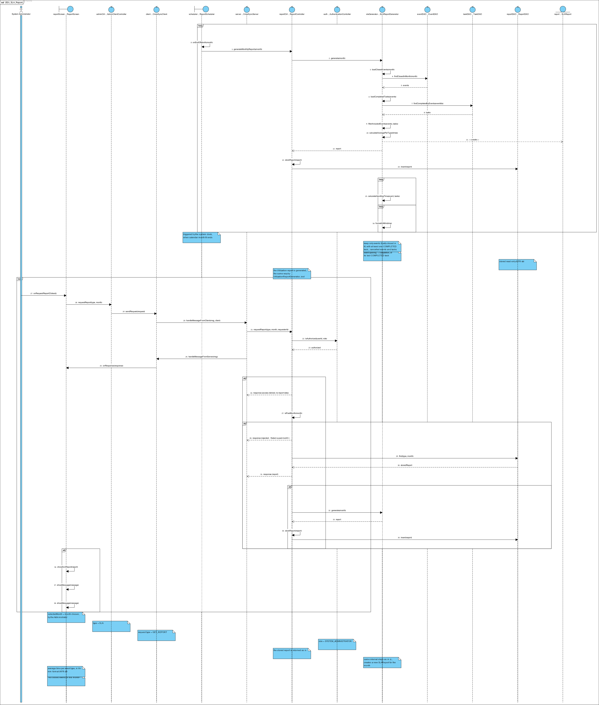

# CrisisSync – Architecture (Group 13)

## 1. Team and Responsibilities
| Name | Role | Area of responsibility |
|------|------|------------------------|
| Lior Shor | Team Lead | Activity Diagrams , Final Model Synchronization |
| Guy Gabi Kikozashvili | Team Member | ECB Class Diagram |
| Amir Kosover | Team Member | Diagram Image Exports (PNGs) & Model Verification against System Narrative and Descriptions |
| Osher Amsalem | Team Member | Sequence Diagrams |

## 2. UML Model
### 2.1 Activity Diagrams

### 2.2 ECB Class Diagram

### 2.3 Sequence Diagrams

### 2.4 Package Diagram

## 3. Design Pattern – Strategy

**Where it is implemented.** `ReservationController` (the *Context*) holds a reference to the
abstract class `AllocationStrategy` (the *Strategy*), which declares a single operation:
`selectBest(requirement, eventLocation, candidates): Resource`.
`NearestLocationStrategy` is the *Concrete Strategy*: it returns the available resource that is
closest to the event location (`Location.distanceTo()`).
When the Dispatcher requests automatic allocation, `ReservationController.autoAllocate(taskId,
criterion, dispatcherId)` calls `getStrategy(criterion)`, which returns the strategy that matches
the `AllocationCriterion` the Dispatcher selected, and then asks it to choose a resource for each
`ResourceRequirement` of the task's package.

**Which requirement it serves.** FR-04 (automatic allocation of a resource package by a selected
criterion) and the project story's demand that *new allocation criteria can be added in the
future*. Adding a criterion means adding one new subclass of `AllocationStrategy` and one new
value to the `AllocationCriterion` enum; `ReservationController`, the reservation transaction and
the client screens do not change (Open/Closed principle).

**Why not a conditional.** Without the pattern, `autoAllocate()` would contain a growing
`switch` on the criterion, and every new criterion would change and re-test the most critical
class in the server (the one that runs the reservation transaction).

## 4. Race Condition Prevention
Which option you implemented (optimistic locking with `version`,
or pessimistic locking with `SELECT ... FOR UPDATE`), the exact SQL,
what happens to the winner and to the losing clients (Conflict Alert),
and how the broadcast keeps all three screens in sync ...