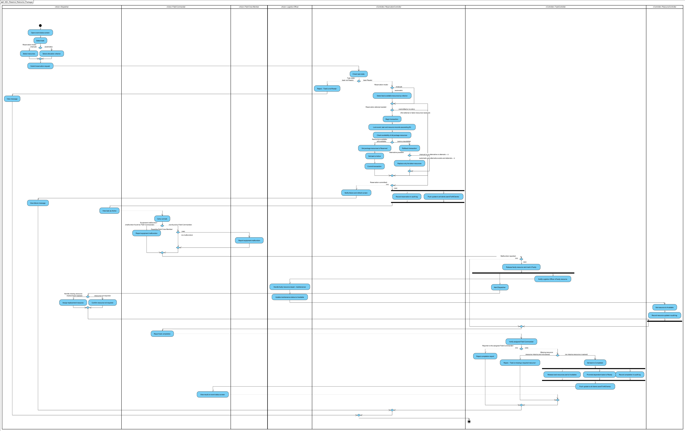
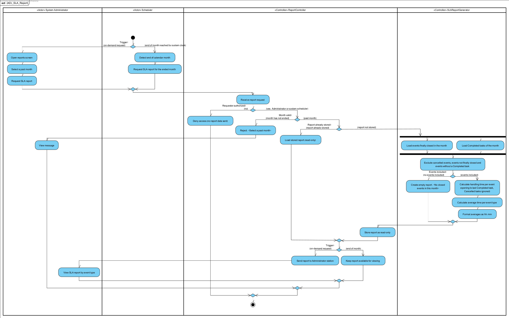

# CrisisSync – Architecture (Group 13)

## 1. Team and Responsibilities
| Name | Role | Area of responsibility |
|------|------|------------------------|
| Lior Shor | Team Lead | Activity Diagrams , Final Model Synchronization |
| Guy Gabi Kikozashvili | Team Member | ECB Class Diagram |
| Amir Kosover | Team Member | Diagram Image Exports (PNGs) & Model Verification against System Narrative and Descriptions |
| Osher Amsalem | Team Member | Sequence Diagrams |

## 2. UML Model
### 2.1 Activity Diagrams

### 2.2 ECB Class Diagram

### 2.3 Sequence Diagrams

### 2.4 Package Diagram

## 3. Design Pattern – Strategy
Where it is, what problem it solves (FR-04, new allocation criteria
can be added without changing ReservationController) ...

## 4. Race Condition Prevention
Which option you implemented (optimistic locking with `version`,
or pessimistic locking with `SELECT ... FOR UPDATE`), the exact SQL,
what happens to the winner and to the losing clients (Conflict Alert),
and how the broadcast keeps all three screens in sync ...